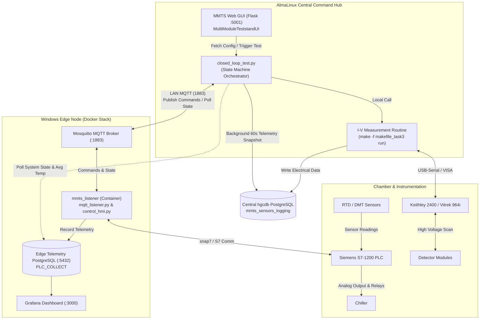

# MMTS Thermal Auto (`mmts-thermal-auto`)

> **Automated Thermal Cycling & Electrical I-V Curve Testing Platform for the CERN CMS HGCAL Multi-Module Test Stand (MMTS)**

[](https://www.python.org/downloads/)
[](https://docs.docker.com/compose/)
[](https://mosquitto.org/)
[](https://www.postgresql.org/)

---

## 📌 Project Overview

`mmts-thermal-auto` is an end-to-end automated testing system developed for mass qualification of silicon detector modules for the **CERN CMS High Granularity Calorimeter (HGCAL)**. 

During quality assurance (QA), silicon sensor modules must undergo rigorous thermal cycling between **-40°C and +20°C** alongside high-voltage reverse-bias **I-V curve scans (up to 850V)** to assess leakage current characteristics and structural integrity.

To overcome the limitations of legacy single-machine prototypes (which required manual human intervention during I-V measurements and bypassed PLC safety interlocks), this project implements a **Distributed IoT Microservices Architecture**:
* **AlmaLinux Core (`almalinux_core`)**: The central command brain that coordinates test workflows, triggers I-V measurements, monitors thermal states, and archives telemetry snapshots to the main experiment database (`hgcdb`).
* **Windows Edge (`windows_edge`)**: The hardware interface node managing the environmental chamber and chiller via a Siemens S7-1200 PLC, running containerized edge microservices via Docker Compose (Mosquitto MQTT, PostgreSQL, Adminer, Grafana, and the MMTS Listener).
* **MMTS Web GUI Companion**: Module configurations, user inspection metadata, and test parameters are managed via the web interface hosted in [MultiModuleTeststandUI](https://github.com/ltsai323/MultiModuleTeststandUI).



---

## ⚡ Current System Capabilities & Features

### 1. 100% "Lights-Out" Automated Closed-Loop Workflow
The main orchestrator (`closed_loop_test.py`) executes a 9-step automated state machine without requiring manual operator intervention:
* **Step 0 (Configuration Fetch & Dynamic Cycle Setup)**: 
  * Automatically retrieves mounted module IDs, inspector info, and user-specified cycle counts from the local Flask Web GUI API (`http://127.0.0.1:5001/api/get_config`).
  * Dispatches dynamic cycle count command (`nCYC_<N>`) over MQTT to the edge node.
* **Step 1 (Baseline Room Temperature Scan)**: Runs initial I-V curve measurement at +20°C up to 500V.
* **Step 2 (Chiller Cooling)**: Dispatches `set_A` via MQTT; waits for PLC state code `4` (Countdown Cooling) and an equilibrium soak period (600s).
* **Step 3 (Cold Baseline Scan)**: Runs low-temperature I-V curve measurement at -40°C up to 500V.
* **Step 4 (Thermal Cycling)**: Dispatches `set_S` then `set_B` to initiate the configured multi-cycle thermal cycling procedure.
* **Step 5 (Post-Cycle Cooling)**: Waits for thermal cycling completion (PLC state `1`: Standby), then drives the system back down to -40°C (`set_A`).
* **Step 6 (High-Voltage Low-Temp Scan)**: Runs I-V curve measurement at -40°C up to the extreme test limit (850V).
* **Step 7 (Chiller Standby)**: Sends `set_S` to safely stop the chiller and begin natural room-temperature recovery.
* **Step 8 (Final Room Temperature Scan)**: Actively polls the real-time database view (`avg1m_air_humidity`) until ambient air returns to 20°C (±2°C), waits 600s for thermal equilibrium, and executes the final 850V I-V scan.

### 2. Dynamically Configurable Thermal Cycle Count
* Unlike earlier implementations restricted to fixed 5-cycle profiles, the **cycle count is now dynamically editable**:
  * Operators configure the desired cycle count directly in the [MultiModuleTeststandUI](https://github.com/ltsai323/MultiModuleTeststandUI).
  * The orchestrator converts this into an `nCYC_<N>` MQTT payload.
  * The edge listener invokes `config_generater.py` on the fly, generating a custom `Set_multi_cycle.yml` tailored to the requested cycle count before launching the PLC recipe.

### 3. Dual-Layer Hardware Safety Interlocks
* Commands (`set_A`, `set_B`, `set_S`) simulate HMI operator button presses in the Siemens PLC (`snap7`), ensuring all hardware-level protections (dew point condensation thresholds, door interlocks, chiller alarms) remain active and authoritative.
* If humidity or dew point levels are unsafe, the PLC hardware autonomously rejects cooling commands to protect expensive silicon modules.

### 4. Fail-Safe Emergency Abort (E-Stop)
* Intercepts `Ctrl+C` (`KeyboardInterrupt`) or unhandled runtime exceptions to immediately trigger `emergency_abort()`:
  1. Issues `set_S` over MQTT to shut down the chiller.
  2. Executes `make -f makefile_task3 stop` and terminates lingering measurement tasks (`pkill make`) to safely ramp down high-voltage power supplies.
  3. Gracefully stops the background database logging thread.

### 5. Real-Time Telemetry & Data Lineage
* **Background Logger Thread**: Runs asynchronously every 60 seconds during thermal tests, querying recent sensor snapshots (RTD temperature sensors, DMT dew point sensors, Chiller status) and writing directly to the central `hgcdb` database (`mmts_sensors_logging`), tying environmental conditions to the corresponding test `batch_id`.
* **Edge Monitoring**: Edge metrics are recorded in PostgreSQL and rendered live on Grafana.

---

## 📂 Repository Structure

```text
mmts-thermal-auto/
├── almalinux_core/                 # Central Orchestrator (AlmaLinux Node)
│   └── mmts-mqtt-bridge/           
│       ├── closed_loop_test.py     # Main state machine test script
│       ├── gateway_setting_example.yml # Sanitized config template
│       ├── gateway_setting.yml     # Active local connection config (git-ignored)
│       ├── pyproject.toml          # uv / Python project dependency definitions
│       ├── uv.lock                 # Deterministic dependency lockfile
│       ├── .python-version         # Python version specification (3.11)
│       └── tests/                  # Standalone test & verification scripts
│           ├── test_pub.py         # Test MQTT publisher
│           ├── test_sub.py         # Test MQTT subscriber
│           └── test_chiller_control.py # Test chiller start/stop signals
│
├── windows_edge/                   # Hardware Edge Services (Windows + Docker)
│   ├── docker-compose.yml          # Builds & runs all 5 edge containers
│   ├── .env.example                # Example environment variables template
│   ├── init_db.sql                 # Telemetry database initialization script
│   └── mmts_listener/              # Edge listener microservice (built by Docker)
│       ├── Dockerfile              # Dockerfile for mmts_listener container
│       ├── requirements.txt        # Listener Python dependencies
│       ├── mqtt_listener.py        # MQTT listener & task dispatcher
│       ├── control_hmi.py          # PLC HMI button simulation via snap7
│       ├── config_generater.py     # Dynamic multi-cycle YAML generator
│       └── plc_io.py               # Low-level snap7 read/write routines
│
├── docs/                           # Documentation assets (diagrams, screenshots)
├── .gitignore                      # Repository gitignore (secrets & venv protection)
└── README.md                       # Repository documentation
```

---

## 🛠️ Installation & Setup Guide

### Part 1: Windows Edge Node Setup

#### Prerequisites
* [Docker Desktop for Windows](https://www.docker.com/products/docker-desktop/) (WSL2 backend recommended).
* Network connectivity to the Siemens S7-1200 PLC and local LAN.
* **Additional Ambient Sensors**: In addition to the 8 PT1000 sensors connected to the PLC analog module, two supplementary RTD PT1000 sensors (`RTD-A01`, `RTD-A02`) connected to a Raspberry Pi 5 can be deployed inside the chamber to measure ambient air temperature and determine relative humidity via an MQTT publisher. If these two sensors are absent, the system falls back to using the temperature sensors from the 1st and 2nd module layers.

#### Container Stack Created by `docker-compose.yml`
The `windows_edge/docker-compose.yml` configuration automatically builds and orchestrates **five core services**:
1. **`mosquitto`**: Eclipse Mosquitto MQTT message broker on ports `1883` (TCP) and `9001` (WebSockets).
2. **`db`**: PostgreSQL 17 time-series database storing sensor telemetry.
3. **`adminer`**: Lightweight web-based database management interface on port `8080`.
4. **`grafana`**: Environmental telemetry dashboard on port `3000`.
5. **`mmts_listener`**: The edge control microservice, **automatically built from `./mmts_listener/Dockerfile`**. It waits for the MQTT broker, listens for commands (`set_A`, `set_B`, `set_S`, `nCYC_<N>`), and translates them into Siemens S7-1200 PLC actions via `snap7`.

#### Setup Steps
1. Navigate to the edge directory:
   ```cmd
   cd windows_edge
   ```
2. Create and configure environment variables in `.env`:
   Copy the provided `.env.example` template to `.env`:
   ```cmd
   copy .env.example .env
   ```
   *(or `cp .env.example .env` in PowerShell / Git Bash)*

   Edit `.env` and fill in your desired database credentials, timezone, and Grafana password:
   ```ini
   # Edge PostgreSQL Database Configuration
   POSTGRES_USER=TIDC_B205
   POSTGRES_PASSWORD=YOUR_TELEMETRY_DB_PASSWORD
   POSTGRES_DB=PLC_COLLECT

   # System Timezone (e.g., Asia/Taipei, Europe/Zurich, UTC)
   TIMEZONE=Asia/Taipei

   # Grafana Dashboard Admin Credentials
   GRAFANA_USER=admin
   GRAFANA_PASSWORD=YOUR_GRAFANA_ADMIN_PASSWORD
   ```
   > **Note**: The `POSTGRES_USER`, `POSTGRES_PASSWORD`, and `POSTGRES_DB` values configured here must match the `database` section in AlmaLinux's `gateway_setting.yml` so the core orchestrator can query sensor data and system states.

3. Build and launch all five containers:

   ```cmd
   docker compose up -d --build
   ```
4. Verify the running services:
   * **Mosquitto MQTT**: `localhost:1883` (WebSockets: `9001`)
   * **PostgreSQL Telemetry DB**: `localhost:5432`
   * **Adminer Web DB Manager**: `http://localhost:8080`
   * **Grafana Dashboard**: `http://localhost:3000`
   * **MMTS Listener**: Active in the background, listening on `plc/s7-1200/temperature/command`.

---

### Part 2: AlmaLinux Core Setup

#### Prerequisites
* AlmaLinux 8 / 9 with Python 3.11.
* [uv](https://docs.astral.sh/uv/) package manager (recommended for fast, reproducible environments).
* Running instance of the companion [MultiModuleTeststandUI](https://github.com/ltsai323/MultiModuleTeststandUI) (default port `5001`).

#### Setup Steps
1. Install `uv` (if not already installed):
   ```bash
   curl -LsSf https://astral.sh/uv/install.sh | sh
   ```
2. Navigate to the core bridge directory:
   ```bash
   cd almalinux_core/mmts-mqtt-bridge
   ```
3. Synchronize Python virtual environment:
   ```bash
   uv sync
   ```
4. Configure database and broker connection parameters:
   ```bash
   cp gateway_setting_example.yml gateway_setting.yml
   ```
   Edit `gateway_setting.yml` to provide valid database credentials and the Windows Edge IP:
   ```yaml
   database:
     DB_HOST: "192.168.x.x"        # Edge PostgreSQL host IP
     DB_PORT: 5432
     DB_USER: "TIDC_B205"
     DB_NAME: "PLC_COLLECT"
     DB_PASSWORD: "YOUR_TELEMETRY_DB_PASSWORD"

   hgcdb:
     DB_HOST: "192.168.x.x"        # Central HGCDB host IP
     DB_PORT: 5432
     DB_NAME: "hgcdb"
     DB_USER: "postgres"
     DB_PASSWORD: "YOUR_HGCDB_PASSWORD"

   mqtt:
     MQTT_BROKER: "192.168.x.x"    # Edge Mosquitto host IP
     MQTT_PORT: 1883
     MQTT_TOPIC: "plc/s7-1200/temperature"
     COMMAND_TOPIC: "plc/s7-1200/temperature/command"
   ```

---

## 🚀 Running the Automated Test

### Method 1: Standard Operation via Web GUI (Recommended)
1. Start the MMTS Web GUI server from [MultiModuleTeststandUI](https://github.com/ltsai323/MultiModuleTeststandUI) (accessible at `http://127.0.0.1:5001`).
2. On the web interface, fill in the test parameters:
   * Module barcodes for all occupied slots
   * Inspector name/ID
   * Target thermal cycle count (`cycleCOUNT`)
3. Click **Configure** (or submit) to save and validate the configuration into the system state.
4. Press the designated button on the MMTS Web GUI to trigger and run the full automated thermal cycling and I-V measurement workflow.

### Method 2: Command-Line Testing & Debugging (AlmaLinux)
For development, standalone testing, or debugging on AlmaLinux, the automated orchestrator can be executed directly from the terminal:
```bash
cd almalinux_core/mmts-mqtt-bridge
uv run python closed_loop_test.py
```
> **Note**: Ensure the MMTS Web GUI server is running on port `5001` with modules configured before starting the CLI test, as `closed_loop_test.py` fetches runtime parameters via `http://127.0.0.1:5001/api/get_config`.
